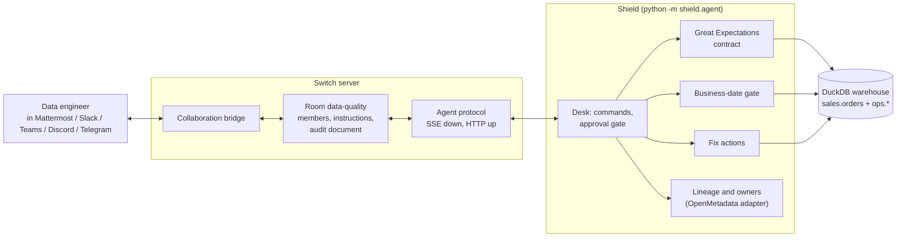

# Shield for data

**Shield is a data quality teammate that lives in your team's chat.** It checks that today's data is really today's, explains what it finds in the channel, proposes a fix, and changes nothing until a person approves. The chat side runs on [Switch](https://github.com/sandbox-quantum/switch).

Built for the [Flip the Switch hackathon](https://www.wemakedevs.org/hackathons/switch) (Track 01, Best Business Workflow).

[](https://github.com/jenniferevangelista-de/shield-for-data/actions/workflows/ci.yml)

> Demo video: _link added on submission_

---

## The problem

Your backfill finished at 07:03. Every dependency was green. But it was processing last Thursday's data, and the gate let it through as today's load.

That is the incident from my article [Your pipeline ran green and shipped last week's data anyway](https://medium.com/@jenniferevangelista.code/a-business-date-gate-for-daily-loads-bc2d45c8f31f) (also on [DEV](https://dev.to/jenniferevangelistade/your-pipeline-ran-green-and-shipped-last-weeks-data-anyway-1il3)). The fix there is a **business-date gate**: record which business date each run processed, let the greatest attempt win, and open the gate only when every required job's newest attempt succeeded for the date the consumer needs.

A gate in a script is half the answer. Someone still has to decide what happens next: hold the 08:00 report, re-run the partition, quarantine the bad rows, tell the finance team. That decision happens in chat, so Shield does too.

## What happens in the channel

```
jen      @shield scan
shield   🚨 F-1 · business_date_gate · critical on sales.orders (business date 2026-11-05)
         Every job ran green this morning, but for business date 2026-10-29, not 2026-11-05.
         The newest partition in sales.orders is 2026-11-04.
         Why it matters: the 08:00 report would show last week's numbers as today's.
         Affected: finance.revenue_daily, ml.churn_features, dashboard.daily_revenue
                   · owners orders-team, finance-analytics, ml-platform, bi-team
         Proposed fix: hold_dashboard + rerun_partition.
         Reply @shield approve F-1, @shield edit F-1 <actions> or @shield reject F-1 <reason>.
jen      @shield approve F-1
shield   F-1 approved by jen. Applied hold_dashboard + rerun_partition:
         - dashboard.daily_revenue is on hold for 2026-11-05.
         - Re-ran the 3 jobs for 2026-11-05 (attempt 1): 999 rows loaded.
         - dashboard.daily_revenue is back on schedule for 2026-11-05.
         ✅ Re-check passed.
```

Every step is written to an audit table and to a **"Shield audit trail" document attached to the room**, so whoever joins the channel later can see who approved what and when.

## The six checks

| Check | How it is detected | Proposed fix |
|---|---|---|
| **Business-date gate** (stale data on a green pipeline) | Run records for the required date (greatest attempt wins) plus a Great Expectations freshness expectation on `max(business_date)` | `hold_dashboard` + `rerun_partition` |
| Row count drop or spike | GX `expect_table_row_count_to_be_between`, bounds from the 7-day median | `hold_dashboard` + `notify_owners` |
| Schema drift | GX `expect_table_columns_to_match_set` against the contract | `hold_dashboard` + `notify_owners` |
| Null rate jump on a key | GX `expect_column_values_to_not_be_null` on `customer_id` (`mostly=0.99`) | `quarantine_partition` + `notify_owners` |
| Duplicate keys | GX `expect_column_values_to_be_unique` on `order_id` | `dedupe_partition` |
| Late or missing upstream file | Arrival records against the expected time | `hold_dashboard` + `notify_owners` |

After an approved fix Shield re-runs every check. If the problem is gone it releases the hold. If the fix has to come from upstream (a renamed column, a missing file), it keeps the report on hold and says so.

The engineer is in charge of the fix, not only the yes or no: `@shield edit F-2 hold_dashboard+notify_owners` replaces the proposal before approving, and `@shield reject F-2 known test load` closes it with a reason and touches no data.

## Why Switch is central

Shield has no web app, no dashboard and no login of its own. The room is its only interface:



What Switch provides, and what Shield would otherwise have to build:

- **The room and its people.** `create_room` makes the `data-quality` room and its Mattermost channel, with Shield and the engineer as members. The same room can be bridged to Slack, Teams, Discord or Telegram without changing Shield.
- **Addressing.** Switch only delivers messages that mention `@shield`, and an agent answers only the people its policy allows. Bootstrap opens the policy to room members through the Gateway, so membership of the room decides who can approve.
- **The approval channel.** The approve, edit and reject commands are just messages in the room. Switch carries the person's name with each one, which is what goes into the audit trail.
- **Shared context.** The audit trail is a room document (`create_room_document` / `update_room_document`), visible to every person and agent in the room.
- **A standard way in.** Shield is a custom agent written against the documented [agent protocol](https://docs.switchagents.ai/flintai/switch/internals/agent-protocol) (`shield/switch_client.py`, about 150 lines): register with `POST /agents` as an `always_on` agent, open the SSE stream with a stable connection id, beat every 2 seconds, call operations with `POST /agents/{id}/ops/{name}`.

## Run it yourself

You need Docker with Compose v2, git and Python 3.11 or newer. It also runs in a GitHub Codespace (4 cores, 16 GB).

```bash
git clone https://github.com/jenniferevangelista-de/shield-for-data.git
cd shield-for-data
python -m venv .venv && . .venv/bin/activate
pip install -e ".[dev]"

bash scripts/up.sh                     # Switch 0.31.0 + Postgres + Gateway + Mattermost, writes .env
python -m shield.agent --bootstrap     # register Shield, create the room, open addressing
python -m shield.agent                 # Shield joins the room and listens
```

`scripts/up.sh` pins the Switch commit the project was tested against and uses ports 18000 (API), 13000 (Gateway) and 18065 (Mattermost), so it does not collide with a Switch you already run.

Then open Mattermost at <http://localhost:18065>, sign in as `user` with the `MATTERMOST_USER_PASSWORD` from `.env`, open the **data-quality** channel and type:

```
@shield help
@shield break stale_business_date
@shield scan
@shield approve F-1
@shield audit
```

`break` and `reset` are demo commands: each one rebuilds a healthy warehouse and seeds one incident. The scenarios are `stale_business_date`, `row_count_drop`, `schema_drift`, `null_spike`, `duplicate_keys` and `late_upstream`.

### Check it without clicking

```bash
pytest                                 # 42 unit tests, no server needed
python scripts/e2e.py                  # a person and Shield go through every scenario in Mattermost
```

The `switch-e2e` job in [CI](.github/workflows/ci.yml) does the whole thing on a fresh GitHub runner: starts Switch, registers Shield, and runs `scripts/e2e.py` against the real server.

### Optional settings

| Variable | Default | What it does |
|---|---|---|
| `SHIELD_LLM_URL` | `http://localhost:11434/v1` | Any OpenAI-compatible chat endpoint. The default is a local [Ollama](https://ollama.com) |
| `SHIELD_LLM_MODEL` | `gemma3:4b` | The model Shield talks to. `gemma3:1b` is faster on a small CPU but misreads more free-form requests |
| `SHIELD_LLM_KEY` | unset | Bearer key, only if your endpoint needs one |
| `SHIELD_LLM` | `on` | `off` turns the model off: fixed explanations and exact commands only (CI runs this way) |
| `OPENMETADATA_URL`, `OPENMETADATA_TOKEN`, `OPENMETADATA_FQN_PREFIX` | unset | Read owners and lineage from OpenMetadata and record incidents there instead of `catalog/lineage.yaml` |
| `SHIELD_ROOM`, `SHIELD_ROOM_USERS` | `data-quality`, `user` | Room name and the chat users added to it |

## The model: small, local, and never in charge

Shield's AI runs on your machine: an open model (Gemma 3 4B by default, or Gemma 3 1B on smaller machines) served by [Ollama](https://ollama.com) through its OpenAI-compatible API, so it is free and no data leaves the host.

```bash
ollama pull gemma3:4b          # once; Shield finds Ollama on localhost:11434
```

It does two jobs:

- **Explains impact.** The "why it matters" line on each finding is written by the model from the check, the summary and the downstream assets. If the model's answer contains a number or runs long, Shield discards it and uses a fixed sentence, because numbers must come from the checks.
- **Understands plain language.** `@shield are today's numbers ok?` becomes `scan`, and `@shield which team owns the orders table?` becomes `who orders`, which Shield resolves to `sales.orders`. Read-only requests run straight away. Anything that changes data does not: `@shield sure, go ahead with F-1` gets "I read that as `@shield approve F-1`. I only change data on an exact command", so a misread can never touch the warehouse.

Without Ollama, Shield still works: it uses the fixed sentences and the exact commands.

## Great Expectations and OpenMetadata

**Great Expectations** (open source, no GX Cloud) holds the data contract for `sales.orders` in [`shield/expectations.py`](shield/expectations.py). Shield builds the suite with an ephemeral context, validates the newest partition, and turns each failed expectation into a finding with the observed value as evidence.

**OpenMetadata** supplies owners and downstream assets. [`shield/catalog.py`](shield/catalog.py) has two implementations of one interface: `MockCatalog` reads [`catalog/lineage.yaml`](catalog/lineage.yaml) and is what the demo uses, and `OpenMetadataCatalog` calls the OpenMetadata REST API (`/tables/name/{fqn}?fields=owners`, `/lineage/table/name/{fqn}`, and `/feed` to open an incident thread on the table). OpenMetadata's full stack needs more memory than a free Codespace has next to Switch, so **the adapter is unit tested against recorded response shapes, not a live server.**

## Project layout

```
shield/
  agent.py          Switch agent: bootstrap, stream, heartbeat, replies, audit document
  switch_client.py  agent protocol client (register, SSE, beat, ops, post)
  desk.py           chat commands and the approval gate, independent of transport
  checks.py         business-date gate + checks built on GX results
  expectations.py   the Great Expectations suite for sales.orders
  fixes.py          fix actions, each audited
  catalog.py        lineage and owners: mock and OpenMetadata adapter
  narrator.py       the local model: impact lines and free-form requests
  warehouse.py      synthetic DuckDB warehouse and control tables
  scenarios.py      the six seeded incidents
  mattermost.py     the person's side, for the end-to-end test
scripts/  up.sh, down.sh, e2e.py
tests/    unit tests
```

## Limits

- The warehouse, owners and incidents are fictional, and the demo is pinned to business date 2026-11-05 so every run is the same.
- Shield's checks run against DuckDB. Pointing them at a real warehouse means replacing `warehouse.py` and the fix actions with your own jobs and tables; the desk, the gate and the Switch side stay the same.
- Room membership is the approval boundary in this demo. A production setup would use a Switch addressing policy that names the approvers.
- The OpenMetadata adapter is untested against a live server (see above).

## License

MIT for this repository. Switch is fetched at setup time under its own license.
