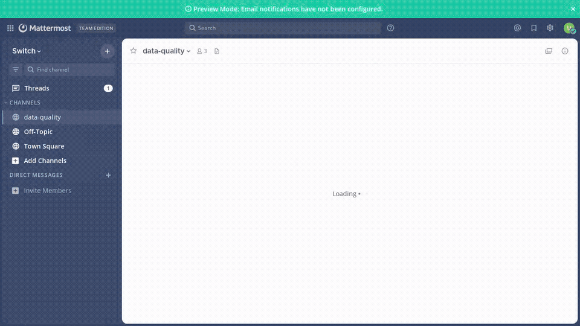
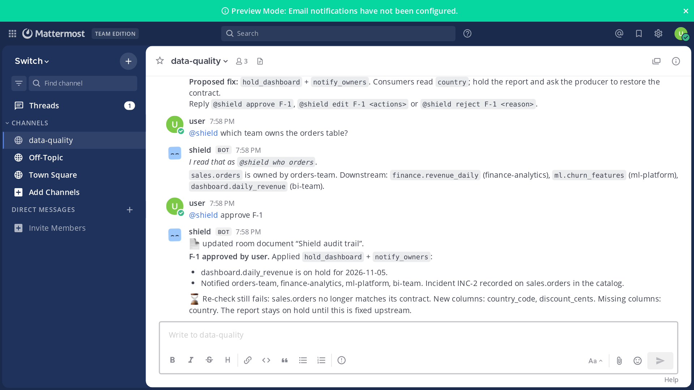
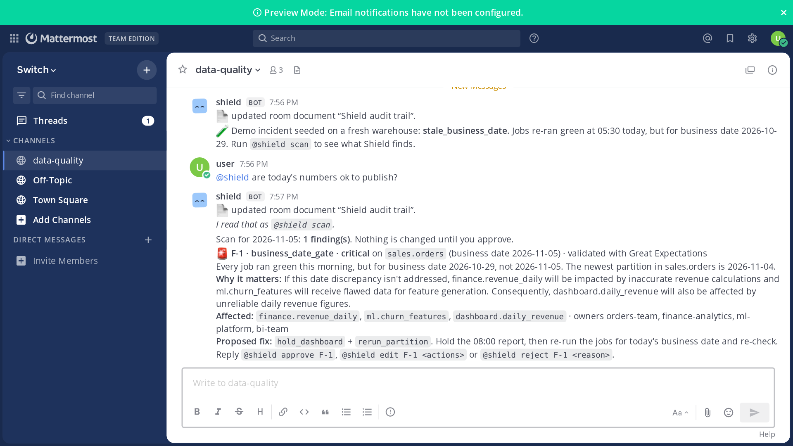
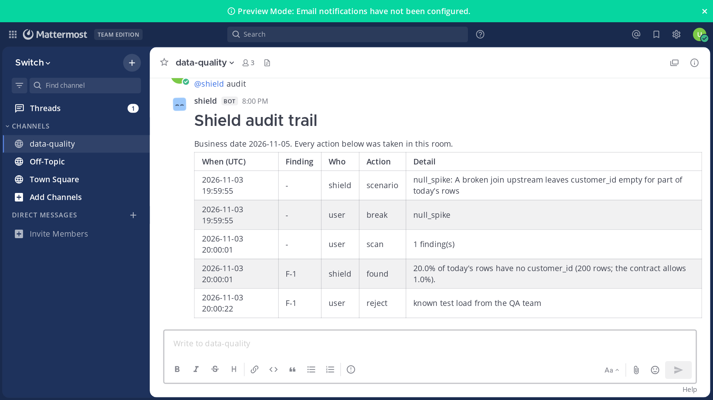

I spent the Flip the Switch hackathon building **Shield**, an agent that checks a daily table, explains what it finds in a team channel and only fixes data after a person approves. This post is the guide I wish I had on day one: how to self-host Switch with no desktop app, how a custom agent joins a room, and the three things that will block you the first time.

Everything here was run on Switch 0.31.0 in a GitHub Codespace. All the data is fictional.

**Shield at a glance**

- **6** incident types caught: stale business date on a green pipeline, row count drop, schema drift, null spike, duplicate keys and a late upstream file
- **5** Great Expectations expectations plus the business-date gate behind those checks
- **5** fix actions, and **0** of them run without a person approving in the chat
- **42** unit tests, plus an end-to-end test that plays every scenario through a real Switch server on a fresh GitHub runner
- **US$ 0** to run: self-hosted Switch, a local open model, free CI

**Watch it work:** [3-minute demo](https://github.com/jenniferevangelista-de/shield-for-data/releases/download/v0.1.0/shield_demo.mp4) · [77-second explainer](https://github.com/jenniferevangelista-de/shield-for-data/releases/download/v0.1.0/shield_explainer.mp4)



## What Switch is, in one paragraph

[Switch](https://github.com/sandbox-quantum/switch) turns a chat channel (Slack, Teams, Discord, Telegram or Mattermost) into a **room** where people and AI agents work together. Switch ships no agents and no models. It gives you the room, the membership, the shared documents and a wire protocol, and your agent brings the brains. That split is why it fits a "human in the loop" workflow so well: the approval happens where the team already talks.

There are two ways in:

- **Switch Console**, the desktop app, runs a server for you and manages Claude Code, Codex or OpenCode agents. This is the 10-minute quickstart.
- **Self-hosting** with the published Docker Compose file, plus any agent that speaks the protocol. This is what I did, because I wanted a custom Python agent and a headless setup I could run in CI.

## Step 1: start a Switch server with its own Mattermost

You need Docker with Compose v2. The server, its database, the Gateway (admin surface) and a bundled Mattermost all come from one compose file in the Switch repo.

```bash
git clone https://github.com/sandbox-quantum/switch.git && cd switch
cp .env.example .env
bash deploy/local/generate-env-secrets.sh .env local   # fills every password and token
sed -i 's/^SWITCH_VERSION=.*/SWITCH_VERSION=0.31.0/' .env
docker compose -f deploy/local/standalone-docker-compose.yml --project-directory . \
  --profile collab --profile gateway up -d
```

Three things worth knowing:

1. **Pin `SWITCH_VERSION`.** The compose file refuses to start without it, on purpose. Take the version from the container registry, not from the GitHub releases page, which tracks the desktop app.
2. **The `collab` profile is Mattermost; `gateway` is the admin surface.** With both on, a `setup` container creates a Mattermost admin, a normal user called `user`, a team called `switch`, and links Mattermost as the default bridge. When `docker wait` on that container returns 0, you are ready.
3. **Ports**: 8000 is the API and the agent bridge, 3000 the Gateway, 8065 Mattermost. Everything binds to 127.0.0.1 by default. In my repo the script moves them to 18000/13000/18065 so they never collide with another Switch.



## Step 2: register a custom agent

An agent is registered once, out of band, with the server's `AGENT_REGISTRATION_TOKEN` from `.env`. For a process that is always running (rather than a session Console starts on demand), use the lower-level `POST /agents` with an `always_on` connection model:

```python
import requests

r = requests.post(f"{SWITCH}/agents", headers={"Authorization": f"Bearer {REGISTRATION_TOKEN}"}, json={
    "name": "shield",                      # what people type after @
    "description": "Data quality teammate",
    "connector_type": "custom-python",
    "integration_profile": {
        "connection_model": "always_on",
        "message_exchange": True,
        "pre_invocation_mediation": [], "post_invocation_mediation": [], "event_reporting": [],
        "command_capabilities": {"reset": "unsupported", "compact": "unsupported", "interrupt": "unsupported"},
    },
    "tools": [], "models": [], "metadata": {}, "overwrite": True,
})
agent_id, api_key = r.json()["id"], r.json()["api_key"]   # the key is shown once: store it
```

The convenience route `POST /agents/register-known` only knows Claude Code, Codex, OpenCode and Antigravity, so a custom agent goes through `POST /agents`.

## Step 3: open the event stream and keep it alive

Down is one Server-Sent Events stream, up is plain HTTP. The part that trips people up is that **the connection is identified by an id you generate**, not by the socket:

```python
conn = str(uuid.uuid4())   # generate once, reuse on every reconnect
stream = session.get(f"{SWITCH}/agents/{agent_id}/events",
                     params={"connection_id": conn, "scope": "single", "filter": "addressed",
                             "rooms": room_id},
                     headers={"Accept": "text/event-stream"}, stream=True)
```

- The first frame is always `connection_state`. Read the `rooms` and `cursor` from it rather than assuming.
- **Beat every 2 seconds** with `POST /agents/{id}/connection/beat` and `{connection_id, cursor}`. The TTL is 6 seconds. A 404 or 409 on the beat means "reopen the stream", not "back off".
- `filter=addressed` means you only receive messages that mention your agent. That is what you want for a chat agent.
- Declare the room on the URL (`rooms=`). A room subscribed after the stream opens can miss its buffered events.

Shield's whole client is about 150 lines: [`shield/switch_client.py`](https://github.com/jenniferevangelista-de/shield-for-data/blob/main/shield/switch_client.py).

## Step 4: create the room, and the channel appears

Operations are `POST /agents/{id}/ops/{name}` with the arguments as the body, plus an `X-Switch-Connection-Id` header when the operation needs a connection. `create_room` on the default bridge creates the Mattermost channel for you:

```python
room = op("create_room", {
    "name": "data-quality",
    "description": "Data quality incidents for sales.orders",
    "agent_names": ["shield"],          # include yourself, or you are not a member
    "user_names": ["user"],             # Mattermost usernames
    "channel_type": "channel_public",
    "instructions": "Shield never changes data without an approval in this room.",
}, connection_id=conn)
```

To answer in the room, `POST /agents/{id}/message` with `{room_id, content}` needs no connection at all. Markdown renders in Mattermost.

## Step 5: the three things that will block you

**1. "You're not permitted to direct messages to me in this room."** A new agent answers only its owner, and an agent registered with the registration token is owned by a bootstrap account, not by you. Nobody can talk to it. The Gateway admin (credentials in `.env`) can clear the policy:

```python
s = requests.Session()
s.post(f"{SWITCH}/gateway/auth/login", json={"email": ADMIN_EMAIL, "password": ADMIN_PASSWORD})
s.put(f"{SWITCH}/gateway/agents/{agent_id}/addressing-policy", json={"policy": None})
```

With no policy, room membership decides who can reach the agent. In production, set a policy that names the people allowed to approve.

**2. "I'm currently offline: my connector isn't reporting in."** Switch answers on your agent's behalf until it sees heartbeats. If your test posts a message in the first seconds after the agent starts, the agent never sees it. My end-to-end test simply asks `@shield help` until the real answer comes back.

**3. Nothing happens and there is no error.** Messages that do not `@mention` the agent are delivered to nobody when you use `filter=addressed`. Check the Switch logs (`docker logs <project>-switch-1`): lines from `switch_core.delivery.addressing` tell you exactly why a message was or was not delivered.

## Step 6: make the human the gate

This is the part that makes it a workflow rather than a bot. Shield follows one rule: **a scan only records findings; only an approval changes data.**



Each finding gets an id and three possible answers, all plain messages in the room:

- `@shield approve F-1` runs the proposed actions, checks again, and posts the result.
- `@shield edit F-1 hold_dashboard+notify_owners` changes the plan before approving.
- `@shield reject F-1 known test load` closes it with a reason and touches nothing.

Switch passes the sender's name with every message, so the audit trail records who decided. Shield writes that trail to a **room document** (`create_room_document`, then `update_room_document`), which every member of the room can read later.



The main check is the business-date gate from my article [Your pipeline ran green and shipped last week's data anyway](https://dev.to/jenniferevangelistade/your-pipeline-ran-green-and-shipped-last-weeks-data-anyway-1il3): the greatest attempt per job and date wins, and a date is ready only when every required job's newest attempt succeeded for that date. The other five checks (schema, row count, nulls, duplicates, late files) are a Great Expectations suite, and owners come from a catalog adapter shaped like OpenMetadata's API.

### Where the AI sits, and where it does not

Shield's language model is a small open model, Gemma 3 4B, served on the same machine by [Ollama](https://ollama.com) through its OpenAI-compatible API, so it costs nothing and no data leaves the host. It has two jobs:

- It writes the "why it matters" line from the finding. If its answer contains a number or runs long, Shield throws it away and uses a fixed sentence, because the numbers have to come from the checks.
- It understands plain language. `@shield are today's numbers ok to publish?` runs a scan. `@shield sure, go ahead with F-1` does **not** approve anything: Shield answers "I read that as `@shield approve F-1`. I only change data on an exact command." A misread can cost a message, never a table.

That boundary is the design choice I would repeat in any agent that touches production data: let the model read and explain, and keep every write behind an exact, human command.

## Step 7: test it like a person would

Mattermost has a plain REST API, so an end-to-end test can log in as the demo user, post `@shield break stale_business_date`, `@shield scan`, `@shield approve F-1`, and wait for each reply. In my repo, that runs on a fresh GitHub Actions runner on every push: start Switch, register Shield, play every scenario. If the test passes, the README is telling the truth.

## What I learned

- **Switch does the parts I did not want to build**: who is in the room, who may talk to the agent, where the shared notes live, and the bridge to whichever chat app the team uses. My agent only had to speak HTTP and SSE.
- **Read the server's answer, not your request.** The `connection_state` frame, the heartbeat response and the addressing logs all tell you what Switch actually decided.
- **Keep the transport out of your logic.** Shield's command handling takes a string and returns replies, so 42 unit tests run with no server at all, and the Switch-specific code stays small.
- **Put the gate in the conversation.** A check that blocks a pipeline is useful. A check that explains itself to the people who own the data, and waits for one of them to decide, is a workflow.

The code, the setup script and the end-to-end test are here: [github.com/jenniferevangelista-de/shield-for-data](https://github.com/jenniferevangelista-de/shield-for-data).
